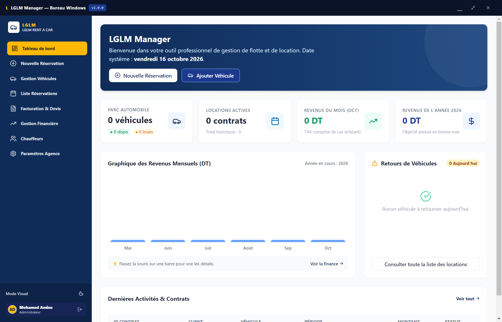
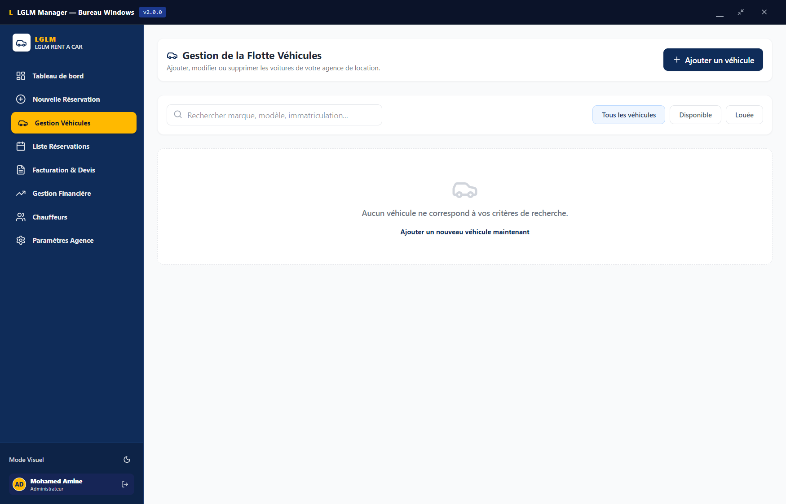
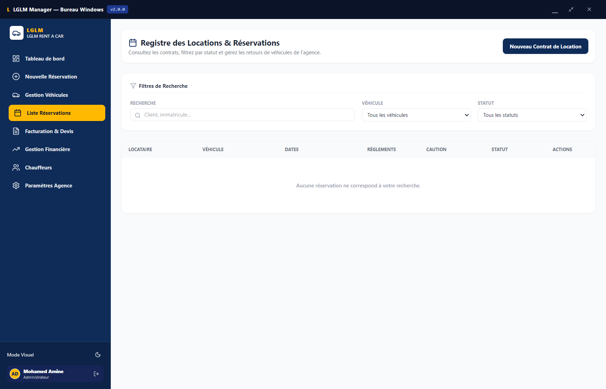
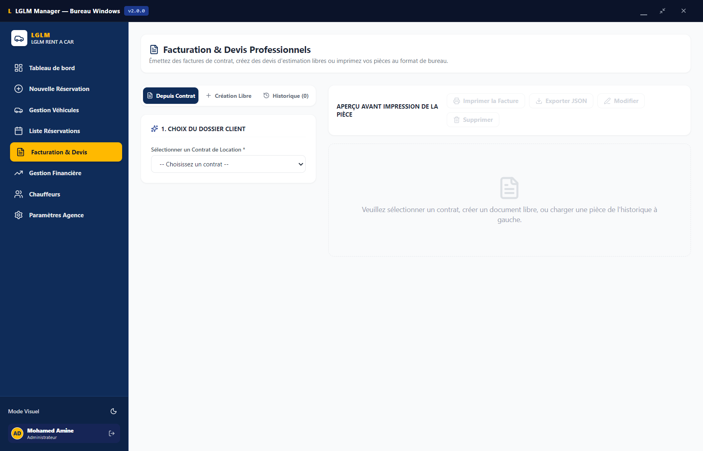
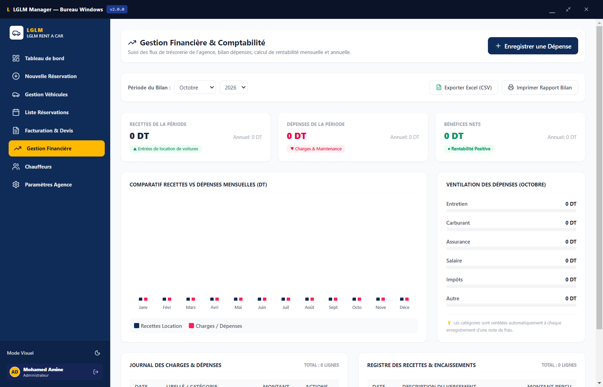
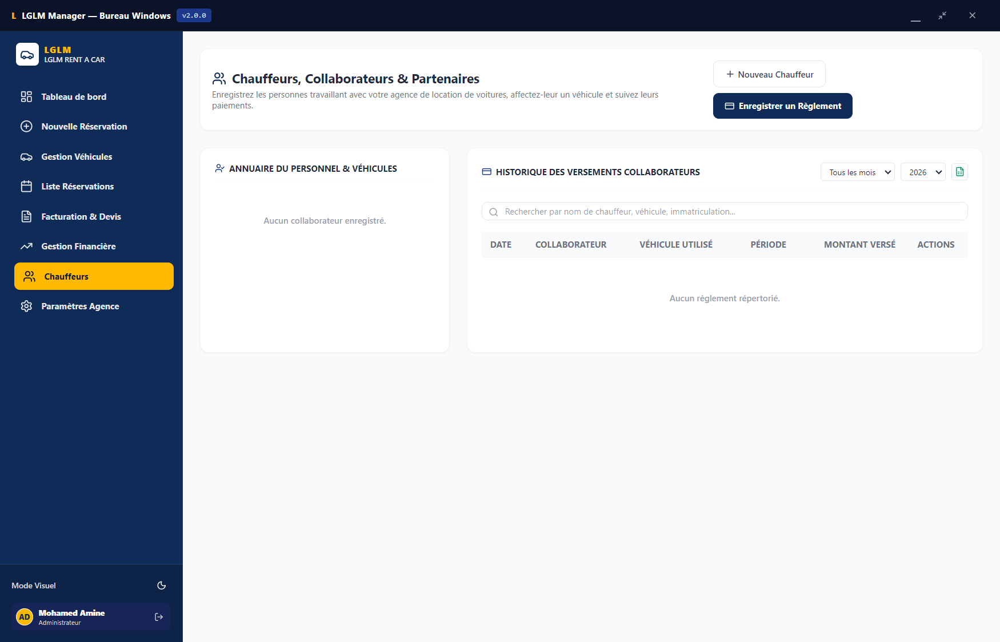
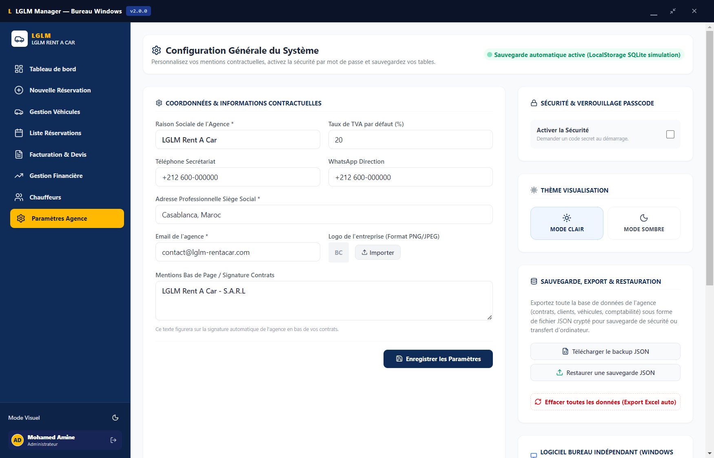

<div align="center">

# 🚗 LGLM Manager

### Système Professionnel de Gestion de Location de Véhicules

[](https://github.com/)
[](https://www.electronjs.org/)
[](https://react.dev/)
[](https://www.typescriptlang.org/)
[](https://tailwindcss.com/)
[](https://www.microsoft.com/windows)
[](LICENSE)

**Application de bureau Windows native tout-en-un pour les agences de location de véhicules.**  
Gestion de flotte, contrats, facturation, finances et chauffeurs — 100% hors-ligne et sécurisée.

<br/>

<p align="center">
  
</p>

---

</div>

## 📋 Table des Matières

- [✨ Fonctionnalités](#-fonctionnalités)
- [🖥️ Captures d'Écran](#️-captures-décran)
- [🏗️ Architecture Technique](#️-architecture-technique)
- [🚀 Installation](#-installation)
- [⚙️ Développement](#️-développement)
- [📦 Compilation de l'Installeur](#-compilation-de-linstalleur)
- [🔐 Sécurité](#-sécurité)
- [📁 Structure du Projet](#-structure-du-projet)
- [📄 Cahier des Charges](#-cahier-des-charges)

---

## ✨ Fonctionnalités

### 📊 Tableau de Bord Intelligent
- KPIs en temps réel : parc automobile, taux de disponibilité, locations actives
- Graphique interactif des revenus mensuels (6 derniers mois)
- Alertes visuelles de **vidange obligatoire** (seuil 9 500 km)
- Alertes de retour de véhicules du jour
- Raccourcis d'actions rapides

### 🚙 Gestion de la Flotte Automobile
- Fiche véhicule complète : immatriculation, marque, modèle, année, couleur, transmission
- Photo du véhicule (stockage Base64)
- Statut dynamique : **Disponible** (vert) / **Louée** (rouge)
- Suivi kilométrique et historique de vidanges
- Tarif journalier par défaut
- Recherche et filtres multicritères

### 👥 Gestion des Clients & Conducteurs
- Base clients avec identité complète (CIN/Passeport, permis, nationalité)
- Support du **2ème conducteur** par contrat
- Création automatique du profil client lors de la réservation

### 📝 Réservations & Contrats de Location
- Cycle de vie complet : *En attente* → *Confirmée* → *En cours* → *Terminée*
- Calculateur intelligent (jours, montant total, acompte, solde restant, caution)
- Kilométrage Aller/Retour
- **Prolongation de contrat** avec recalcul automatique
- Génération de contrat professionnel prêt à l'impression (A4)
- Signature manuscrite intégrée (canvas)

### 🧾 Facturation & Devis Professionnels
- **Depuis un contrat existant** : récupération automatique des données
- **Création libre / Devis estimatif** : formulaire polyvalent sans contrat préalable
- Calculs fiscaux : Montant HT, TVA paramétrable, Montant TTC
- Numérotation séquentielle normalisée (`FACT-YYYY-XXXX` / `DEV-YYYY-XXXX`)
- Modification en place et suppression sécurisée
- Aperçu avant impression et export JSON
- Montant en lettres (Dinars Tunisiens)

### 💰 Gestion Financière & Trésorerie
- Suivi des recettes (automatiques + manuelles)
- Suivi des dépenses par catégorie (Carburant, Entretien, Assurance, Impôts, Salaires, Autre)
- Bilan financier en direct : CA total, charges, bénéfice net
- Export Excel (.xlsx) des états financiers

### 🤝 Chauffeurs & Collaborateurs
- Annuaire des chauffeurs avec attribution de véhicule
- Registre des paiements mensuels
- Enregistrement automatique en charge salariale

### ⚙️ Paramètres & Sécurité
- Identité complète de l'agence (logo, coordonnées, TVA)
- 🔒 Écran de verrouillage à **code PIN** (SHA-256)
- 🛡️ Protection anti brute-force (5 tentatives, verrouillage 5 min)
- Thème Clair / Sombre
- Sauvegarde JSON complète / Restauration / Export Excel
- Réinitialisation avec sauvegarde automatique de précaution

---

## 🖥️ Captures d'Écran

### 1. Tableau de Bord (Dashboard)
Vue synthétique de l'agence : métriques du parc, graphiques des revenus, alertes de vidange et retours planifiés.


### 2. Gestion de la Flotte Automobile
Catalogue de l'ensemble des véhicules avec statut instantané (Disponible / Louée), kilométrage et alertes.


### 3. Réservations & Contrats de Location
Gestion des contrats en cours, historique client, acomptes et solde avec impression de contrat instantanée.


### 4. Facturation & Devis
Édition de factures et devis conformes aux normes comptables avec calcul automatique de la TVA.


### 5. Gestion Financière & Trésorerie
Suivi des entrées, sorties par catégorie et calcul en direct du résultat net d'exploitation.


### 6. Gestion des Chauffeurs & Collaborateurs
Suivi des collaborateurs, commissions et salaires imputés en charges réelles.


### 7. Paramètres & Sécurité
Personnalisation des coordonnées de l'agence, logo, TVA, code PIN de verrouillage et gestion des sauvegardes.


---

## 🏗️ Architecture Technique

| Composant | Technologie | Rôle |
|:---|:---|:---|
| **Langage** | TypeScript 5.8 | Typage statique strict |
| **Framework UI** | React 19 | Interface réactive et modulaire |
| **Bundler** | Vite 6 | Compilation ultra-rapide, HMR |
| **Styling** | Tailwind CSS 4 | Design moderne, responsive, print-ready |
| **Icônes** | Lucide React | Bibliothèque d'icônes SVG légères |
| **Animations** | Motion (Framer Motion) | Micro-animations fluides |
| **Desktop** | Electron 31 | Runtime bureau Windows natif |
| **Installeur** | Electron Builder + NSIS | Génération du `.exe` autonome |
| **Persistance** | LocalStorage + IPC File System | 100% hors-ligne, réplication disque |
| **Export** | SheetJS (XLSX) | Export Excel professionnel |
| **Sécurité** | Web Crypto API (SHA-256) | Hachage du code d'accès |

---

## 🚀 Installation

### Méthode 1 — Installeur Windows (Recommandée)

1. Téléchargez le fichier `LGLM Manager Setup 2.0.0.exe` depuis la section [Releases](https://github.com/)
2. Double-cliquez sur l'installeur
3. L'application s'installe et se lance automatiquement

> 💡 Aucune dépendance requise. L'application fonctionne de manière autonome et 100% hors-ligne.

### Méthode 2 — Depuis le code source

**Prérequis :** [Node.js](https://nodejs.org/) (v18 ou supérieur)

```bash
# Cloner le dépôt
git clone https://github.com/aminezz21/lglm-manager.git
cd lglm-manager

# Installer les dépendances
npm install

# Lancer en mode développement (navigateur)
npm run dev
```

L'application sera accessible à l'adresse : `http://localhost:3000`

---

## ⚙️ Développement

### Scripts Disponibles

| Commande | Description |
|:---|:---|
| `npm run dev` | Serveur de développement Vite (port 3000) |
| `npm run build` | Compilation du frontend pour la production |
| `npm run preview` | Prévisualisation du build de production |
| `npm run lint` | Vérification TypeScript (`tsc --noEmit`) |
| `npm run electron:dev` | Lancement en mode bureau (build + Electron) |
| `npm run electron:build` | Compilation de l'installeur Windows `.exe` |
| `npm run clean` | Nettoyage des dossiers `dist/` et `dist_desktop/` |

### Mode Bureau (Electron)

```bash
# Tester l'application en mode bureau
npm run electron:dev

# Compiler l'installeur Windows autonome
npm run electron:build
```

---

## 📦 Compilation de l'Installeur

La commande suivante génère un installeur Windows NSIS :

```bash
npm run electron:build
```

Le fichier sera disponible dans :
```
dist_desktop/LGLM Manager Setup 2.0.0.exe
```

### Configuration de l'Installeur

| Paramètre | Valeur |
|:---|:---|
| Format | NSIS (One-Click) |
| Plateforme | Windows (x64) |
| Raccourci Bureau | ✅ Automatique |
| Raccourci Menu Démarrer | ✅ Automatique |
| Installation par utilisateur | ✅ (pas besoin d'admin) |

---

## 🔐 Sécurité

L'application intègre plusieurs couches de sécurité :

- **🔑 Hachage SHA-256** — Le code PIN est haché avec un sel via la Web Crypto API (jamais stocké en clair)
- **🛡️ Anti brute-force** — Verrouillage automatique après 5 tentatives échouées (5 minutes)
- **🧹 Sanitisation des entrées** — Protection anti-XSS et anti-injection sur tous les champs de saisie
- **✅ Validation des imports** — Vérification de structure et de taille avant toute restauration de base de données
- **📋 Journal de sécurité** — Historique des connexions, tentatives échouées et événements sensibles
- **🔒 Isolation Electron** — `contextIsolation: true`, `nodeIntegration: false`, bridge IPC sécurisé

---

## 📁 Structure du Projet

```
lglm-manager/
├── src/
│   ├── App.tsx                    # Composant principal, routing, state management
│   ├── main.tsx                   # Point d'entrée React
│   ├── types.ts                   # Interfaces TypeScript (Car, Client, Reservation...)
│   ├── index.css                  # Styles globaux
│   ├── components/
│   │   ├── Dashboard.tsx          # Tableau de bord & KPIs
│   │   ├── CarManagement.tsx      # Gestion de la flotte automobile
│   │   ├── ReservationForm.tsx    # Formulaire de réservation & contrat
│   │   ├── ReservationList.tsx    # Liste & gestion des locations
│   │   ├── Billing.tsx            # Facturation & devis
│   │   ├── Finance.tsx            # Gestion financière & trésorerie
│   │   ├── Collaborators.tsx      # Chauffeurs & paiements
│   │   ├── Settings.tsx           # Paramètres agence & sécurité
│   │   ├── LoginScreen.tsx        # Écran de verrouillage PIN
│   │   └── ErrorBoundary.tsx      # Gestion des erreurs React
│   ├── utils/
│   │   ├── db.ts                  # DBManager — CRUD & persistance des données
│   │   ├── security.ts            # Module de sécurité (hachage, brute-force, sanitisation)
│   │   └── numberToWords.ts       # Conversion montant en lettres (Dinars)
│   └── assets/
│       └── images/                # Logo et ressources visuelles
├── electron-main.cjs              # Process principal Electron
├── preload.cjs                    # Bridge IPC sécurisé (contextBridge)
├── index.html                     # Point d'entrée HTML
├── package.json                   # Dépendances & configuration Electron Builder
├── vite.config.ts                 # Configuration Vite + Tailwind
├── tsconfig.json                  # Configuration TypeScript
├── CAHIER_DES_CHARGES.md          # Spécifications fonctionnelles détaillées
└── .gitignore
```

---

## 🗄️ Base de Données

L'application utilise un système de persistance hybride :

| Mode | Stockage | Emplacement |
|:---|:---|:---|
| **Navigateur Web** | `localStorage` | Mémoire du navigateur |
| **Electron (Bureau)** | Fichier JSON sur disque | `%APPDATA%/lglm-manager/lglm_database.json` |

> Les deux modes sont synchronisés automatiquement. Les données persistent même après fermeture de l'application.

### Sauvegarde & Restauration

- **Export JSON** — Téléchargement complet de la base de données
- **Export Excel** — Fichier `.xlsx` multi-onglets (Véhicules, Clients, Réservations, Factures, Dépenses, Revenus, Chauffeurs)
- **Import JSON** — Restauration intégrale avec validation de sécurité
- **Réinitialisation** — Remise à zéro avec export Excel automatique de précaution

---

## 📄 Cahier des Charges

Le document complet de spécifications fonctionnelles et techniques est disponible dans [`CAHIER_DES_CHARGES.md`](CAHIER_DES_CHARGES.md).

---

## 🏷️ Historique des Versions

| Version | Description |
|:---|:---|
| **v2.0.0** | Version majeure — Sécurité SHA-256, anti brute-force, sanitisation, correction du passcode |
| **v1.9.0** | Facturation libre & devis, prolongation de contrats, export Excel complet |
| **v1.7.8** | Vidange proactive, alertes retour, graphique revenus mensuels |
| **v1.6.0** | Système de facturation depuis contrat, gestion financière avancée |
| **v1.5.0** | Module Chauffeurs & Collaborateurs, paiements salariaux automatiques |
| **v1.4.2** | Première version stable avec installeur Windows NSIS |

---

## 📜 Licence

Ce logiciel est un produit propriétaire développé pour **LGLM Rent A Car**.  
Tous droits réservés © 2026.

---

<div align="center">

**Développé avec ❤️ pour les agences de location de véhicules**

[](https://react.dev/)
[](https://www.typescriptlang.org/)
[](https://www.electronjs.org/)

</div>
